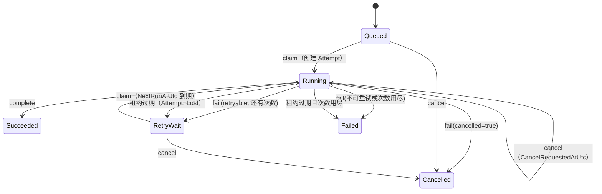

# AOS-005 交付报告：Task Queue & Lease Management

**状态：Completed**
**完成时间：2026-11-07**
**任务文件：** `tasks/AOS-005-task-queue.md`

## 1. 任务目标

实现 SQL Server 持久化任务队列服务端能力：原子领取、租约、心跳、超时恢复、重试与取消。
本地常驻 Runner 程序由 AOS-006 实现。

## 2. 实现摘要

### 2.1 数据模型（迁移 `20261106144413_AddTaskQueue`）

| 变更 | 说明 |
|---|---|
| `Workers` | Runner 身份：`WorkerCode` 唯一、`Status`（Online/Offline/Disabled）、能力与心跳时间 |
| `TaskAttempts` | 每次执行一行，`(TaskId, AttemptNumber)` 唯一；状态 Running/Succeeded/Failed/Lost/Cancelled |
| `Tasks` 扩展 | `LeaseOwnerWorkerId`（FK Workers）、`LeaseTokenHash`、`LeaseExpiresAtUtc`、`LastHeartbeatAtUtc`、`StartedAtUtc`、`CompletedAtUtc`、`CancelRequestedAtUtc`、`ErrorCode`、`ErrorMessage` |
| 索引 | `IX_Tasks_LeaseExpiresAtUtc`、`UX_TaskAttempts_Task_Attempt`、`IX_TaskAttempts_WorkerId` |

### 2.2 原子领取（真实并发测试驱动修正）

最初实现使用 `SELECT ... WITH (UPDLOCK, READPAST, ROWLOCK)` + 更新：并发测试发现
`UPDLOCK` 会把扫描到的行锁保持到事务结束，其他 Runner 的 `READPAST` 全部跳过，结果
**只有一个 Runner 能领到任务**（实测每轮 4 个 Runner 只有 1 个成功）。

改为两阶段无锁竞争：

1. **无锁扫描候选**：按 `Priority`（urgent→low）、`CreatedAtUtc`、`Id` 排序，只取
   `Status IN (Queued, RetryWait)` 且 `NextRunAtUtc <= now` 的任务，最多 `capacity` 个；
2. **逐条条件更新**：`UPDATE ... WHERE Id = @id AND Status IN (...) AND NextRunAtUtc <= @now`
   并 `OUTPUT inserted.*`；更新成功的行才创建 `TaskAttempt` 与租约；
3. 被并发抢走的候选丢弃，下一轮重新选择（最多 4 轮），避免空转。

同一事务内完成任务更新、租约写入和 Attempt 创建；`(TaskId, AttemptNumber)` 唯一索引保证
不会重复创建同一次尝试。

### 2.3 租约与 Token

- Token：256 位 `RandomNumberGenerator`，Base64Url，**只在 Claim 响应返回一次**。
- 数据库保存 SHA-256（小写十六进制），比较使用 `FixedTimeEquals`。
- `start` / `heartbeat` / `complete` / `fail` 都校验 WorkerId + TaskId + AttemptId + Token +
  租约未过期 + Attempt 状态；任何一项不匹配返回 403/409，不能只凭 TaskId 操作。
- 心跳/开始会把租约延长 `LeaseDurationSeconds`。

### 2.4 状态流转

- Running 取消不会立即改状态：设置 `CancelRequestedAtUtc`，Runner 通过心跳看到
  `cancelRequested=true` 后终止进程并调用 `fail(cancelled=true)` 落为 Cancelled。
- 已请求取消的任务调用 `complete` 返回 409 `cancel-requested`，不会被误记为成功。

### 2.5 后台恢复

`AgentOS.Worker` 新增 `LeaseRecoveryWorker`（BackgroundService，间隔可配置）：

1. 找出 `Status=Running` 且 `LeaseExpiresAtUtc <= now` 的任务；
2. 对应 Attempt 置 `Lost`，清空租约；
3. `AttemptCount < MaxAttempts` → `RetryWait`，`NextRunAtUtc = now + base*2^(n-1)`（上限
   `BackoffMaxSeconds`，另加 0–29 秒由 TaskId 派生的确定性抖动），否则 `Failed`；
4. 一轮失败只记录错误，不影响后续扫描。

### 2.6 API

| 方法 | 路径 | 行为 |
|---|---|---|
| POST | `/api/v1/runners/claim` | 原子领取（容量 1–100，超过 `ClaimBatchLimit` 截断） |
| POST | `/api/v1/runners/tasks/{id}/start` | 记录 external session、续租 |
| POST | `/api/v1/runners/tasks/{id}/heartbeat` | 续租，返回 `cancelRequested` |
| POST | `/api/v1/runners/tasks/{id}/complete` | 成功收尾（exitCode） |
| POST | `/api/v1/runners/tasks/{id}/fail` | 失败/取消收尾（retryable、cancelled） |
| POST | `/api/v1/tasks/{id}/cancel` | 管理端取消 |

- Runner 端点要求 `X-AgentOS-Dev-Key` + `X-AgentOS-Worker-Code`（必须对应 Online Worker）；
  普通 API 客户端没有注册的 Worker 身份就无法冒充 Runner。AOS-006 会替换为正式 Runner 凭证。
- 错误语义：404 不存在、403 Worker/Token/租约问题、409 状态冲突，`code` 为稳定错误码。

## 3. 验收项对照

| 验收标准 | 证据 |
|---|---|
| 多 Runner 并发领取不会领取同一任务 | `SqlTaskQueueTests.Concurrent_claims_hand_each_task_to_exactly_one_worker`：4 个 Runner 并发、容量 4，断言无重复 TaskId/Token；随后 drain 至 12 个任务全部领取 |
| Claim 与 Attempt 创建事务一致 | 同一事务内更新任务 + 创建 Attempt；并发测试断言 12 个 Running 任务与 12 个 Running Attempt 一一对应 |
| Heartbeat 可续租 | `TaskQueueServiceTests.Heartbeat_extends_the_lease` + SQL 用例断言 `LeaseExpiresAtUtc = now+120s` |
| 无效/过期租约不能更新任务 | `Heartbeat_rejects_a_wrong_token` / `Heartbeat_rejects_an_expired_lease` / SQL `wrong token` → 403 |
| 过期租约可自动恢复 | SQL `Expired_lease_is_recovered_then_retried_by_a_new_claim`：Attempt→Lost、任务→RetryWait、到期后第二次领取 AttemptNumber=2，历史 Attempt 保留 |
| 重试次数和退避正确 | `Retryable_failure_requeues_with_backoff`、`Last_attempt_failure_marks_the_task_failed`、SQL `Fail_retries_until_max_attempts_then_marks_the_task_failed` |
| 取消任务状态正确 | `Cancel_marks_a_queued_task_cancelled`、`Cancelling_a_running_task_requests_cancellation...`、`Complete_is_rejected_after_a_cancel_request` |
| 服务重启后任务仍存在 | 全部状态在 SQL Server；无内存状态 |
| 真实 SQL Server 并发测试通过 | 5 个 SQL 队列用例通过（数据库 `AgentOS_Test`） |

## 4. 测试命令与结果

| 检查 | 命令 | 结果 |
|---|---|---|
| 后端构建 | `dotnet build backend/AgentOS.slnx` | ✅ 0 错误 |
| 全量测试（含 SQL） | 工作区外 `dotnet vstest` / CI `dotnet test` | ✅ **175 通过 / 0 失败** |
| 迁移 | `dotnet ef database update` | ✅ `AddTaskQueue` 已应用 |
| 前端 | 无改动 | — |

## 5. 安全检查

- 租约 Token 明文只返回一次，数据库只存 SHA-256；恒定时间比较。
- 所有 Runner 操作校验 Worker + Task + Attempt + Token + 过期时间，不能凭 TaskId 越权。
- Runner 端点需要已注册且 Online 的 Worker 身份，未注册/禁用返回 401/403。
- 领取只处理启用项目下的任务；取消与完成互斥（取消请求后不允许成功）。
- 未执行生产操作；迁移只作用于本地开发库与可丢弃测试库。

## 6. 已知限制

1. Runner 身份仍是“开发 Key + Worker Code”占位，AOS-006 改为真正的 Runner 凭证。
2. 没有 Worker 注册/心跳 API（AOS-006），本地需手工插入 Worker 行（见 `DEVELOPMENT.md` §11.4）。
3. 没有任务列表/详情 API（AOS-008 与前端需要）。
4. `MaxParallel` / 项目级并发限制尚未在领取时强制，AOS-006/调度增强再补。
5. 领取是尽力而为：并发极高时某个 Runner 可能本轮领到少于容量，下一轮继续；这是为吞吐
   与无重复所做的取舍，不影响正确性。
6. 队列没有公平性保证（按优先级与创建时间，可能饿死低优先级任务），后续可加配额或老化。

## 7. 未完成事项

AOS-005 验收范围内无未完成项。以下按任务边界推迟：

- AOS-006：Runner 注册、凭证、心跳上报、领取循环；
- AOS-007：Codex Adapter；
- AOS-008：任务列表 API、日志/产物、可观测性；
- 并发配额（MaxParallel）与公平调度。

## 8. 下一任务建议

AOS-006 Local Runner：

1. Runner 注册与凭证（替换 Worker Code 占位）；
2. 长轮询/短轮询领取 + 心跳 + 退避重连；
3. 领取后调用 Start，执行任务（AOS-007 接入 Codex），Complete/Fail 回传；
4. 进程崩溃/断网后的租约丢失与重新领取路径。

## 9. 变更文件清单

### 新增（后端）

| 路径 | 说明 |
|---|---|
| `backend/AgentOS.Domain/Workers/Worker.cs` | Worker 实体与状态 |
| `backend/AgentOS.Domain/Tasks/TaskAttempt.cs` | Attempt 实体与状态 |
| `backend/AgentOS.Application/Tasks/TaskQueueOptions.cs`、`LeaseTokenService.cs`、`TaskQueueContracts.cs`、`TaskQueueRequests.cs`、`TaskQueueService.cs`、`LeaseRecoveryService.cs`、`TaskBackoff.cs` | 队列应用层 |
| `backend/AgentOS.Infrastructure/Tasks/TaskClaimer.cs`、`TaskQueueStore.cs` | 原子领取与存储 |
| `backend/AgentOS.Infrastructure/Persistence/Configurations/WorkerConfiguration.cs`、`TaskAttemptConfiguration.cs` | EF 配置 |
| `backend/AgentOS.Infrastructure/Migrations/20261106144413_AddTaskQueue*.cs` | 迁移与快照 |
| `backend/AgentOS.Api/Filters/RunnerAuthenticationFilter.cs`、`Endpoints/RunnerEndpoints.cs`、`Endpoints/TasksEndpoints.cs` | Runner/任务 API |
| `backend/AgentOS.Worker/LeaseRecoveryWorker.cs` | 过期租约后台恢复 |

### 新增（测试）

| 路径 | 说明 |
|---|---|
| `tests/AgentOS.Api.Tests/LeaseTokenServiceTests.cs`、`TaskBackoffTests` | Token 与退避 |
| `tests/AgentOS.Api.Tests/TaskQueueServiceTests.cs`、`LeaseRecoveryServiceTests.cs` | 生命周期与恢复 |
| `tests/AgentOS.Api.Tests/SqlTaskQueueTests.cs` | 真实 SQL 并发/恢复/重试 |
| `tests/AgentOS.Api.Tests/RunnerApiTests.cs` | Runner API 契约与鉴权 |
| `tests/AgentOS.Api.Tests/Fakes/FakeTaskQueueStore.cs` | 测试替身 |

### 修改

- `backend/AgentOS.Domain/Tasks/AutomationTask.cs`：租约/取消/错误字段；
- `backend/AgentOS.Infrastructure/Persistence/AgentOSDbContext.cs`、`AutomationTaskConfiguration.cs`、`DependencyInjection.cs`；
- `backend/AgentOS.Api/Program.cs`、`appsettings.json`；`backend/AgentOS.Worker/Program.cs`、`appsettings.Development.json`；
- `tests/AgentOS.Api.Tests/AgentOSApiFactory.cs`；
- `docs/DATABASE-ER.md`、`docs/DEVELOPMENT.md`、`tasks/AOS-005-task-queue.md`。
